# MolGenDraw 🧪

**MolGenDraw** is your intuitive 2D molecular editor with **interactive 3D visualization**! Draw, edit, and explore molecular structures with real-time analysis. Featuring ring/structure templates, SMILES support, PubChem integration, and advanced SDF database support—seamlessly merge `.mol` files and edit custom tags. Now with 3D molecular rendering, animation recording, structure OCR, and batch IUPAC-to-SMILES generation. A fast, beautiful, and portable chemistry app designed for researchers, chemists, and students!

🆕 **Current Version**  
Version: 1.176 (Second Official Stable Release)  
Build Date: October 29, 2026  
Platform: Windows 64-bit (Standalone Executable)  

---

✨ **Features**

🎨 **Interactive 2D Canvas & Drawing Tools**  
- Intuitive tools to draw, edit, and manipulate molecular structures directly on the canvas.  
- Easily add atoms, cycle through bond orders (single, double, triple), and fuse predefined ring templates (Benzene, Cyclohexane, Cyclopentane, etc.).  

🔄 **Advanced Canvas Manipulation & Selection**  
- Robust selection tool to interact with specific parts of a molecule.  
- Rotate structures freely up to 360 degrees using the mouse, or perform 180-degree vertical and horizontal flips for optimal layout.  

🎭 **Customizable Visual Styling & Display Options**  
- Dynamically change bond width (thickness) for better visibility.  
- Toggle options to show or hide methyl (CH3 and CH2) labels and implicit/explicit hydrogen atoms for cleaner or more detailed structural views.  

📂 **Advanced SDF File Management** *(Signature Feature)*  
- Seamlessly navigate through multi-molecule Structure-Data Files (`.sdf`).  
- Edit, create, or delete specific SDF tags/properties via a dedicated tag editor.  
- **SDF Generator**: Merge multiple standalone `.mol` files into a single, organized `.sdf` database file (outshining the limited SDF support in tools like ChemDraw, ChemSketch or Ketcher etc).  
- Options to "Save Current Molecule Only" or delete specific records with confirmation dialogs.  
- Bookmarks feature with navigation buttons for quick access to important records.  
- Resolved distortion issue when SDF molecules with 3D coordinates are loaded into the 2D canvas.  

📊 **Real-Time Molecular Analysis**  
- Automatically calculate and display key chemical properties as you draw.  
- Instant updates for Molecular Formula, Molecular Weight, Exact Mass, Elemental % Composition, InChI String, and InChI Key.  

🌐 **PubChem Data Integration**  
- Built-in PubChem Data Retriever connects to the PubChem API.  
- Enter a compound name, molecular formula, or SMILES string to instantly retrieve comprehensive chemical data, display it in a formatted popup, **auto-load the molecular structure onto the canvas**, and auto-copy to the system clipboard.  
- Search current molecule on Google / PubChem using its InChI Key.  

🧊 **Interactive 3D Molecular Visualization & Animation** *(New in v1.176)*  
- Visualize the currently loaded molecule in an interactive 3D view.  
- Manually rotate the structure with the mouse or animate it automatically in horizontal or vertical modes.  
- Multiple rendering styles: **WireFrame**, **Sticks**, and **Ball & Stick**.  
- Show or hide resonance representations and hydrogen atoms.  

🎥 **3D Animation Recording as MP4 Video** *(New in v1.176)*  
- Record the 3D animation as an **MP4 video file (720p resolution)** saved in the **"Output"** folder.  
- Playback inside the editor or using any media player (like VLC or Windows Media Player).  
- Free version can record 20-second-long videos with **no limit on the number of videos recorded**.  

🔬 **Chemical Structure OCR Utility** *(New in v1.176)*  
- Convert chemical structure images into editable MOL files using the built-in Structure OCR utility.  
- Select a folder containing PNG or JPG structure images and MolGenDraw automatically processes the batch.  
- Converted structures are saved in a new **"ocr_date-time"** folder under the **"Output"** directory.  

🧪 **IUPAC-to-SMILES Batch Generator** *(New in v1.176)*  
- Generate SMILES strings from IUPAC names without manual conversion.  
- Type names directly into the text area (one per line) or load a text file for batch processing.  
- Creates a timestamped **".smi"** file in the **"Output"** folder (format: `smi_date-time.smi`).  
- The resulting `.smi` file can be opened in MolGenDraw as a navigable molecular database.  

📑 **Advanced Export Options**  
- Generate professional, single-page A4 PDF files containing the molecular structure alongside a detailed analysis report.  
- Export high-quality PNG images with transparent backgrounds.  
- Save the current molecule as a reusable custom template for future drawing sessions.  

📁 **Enhanced Multi-Molecule SMILES File Management** *(New in v1.176)*  
- Load multi-record **".smi"** files and navigate between records.  
- Delete the currently displayed molecule from the file, save the collection as a new **".smi"** file, or export only the current molecule as **MOL/SMI/SDF/PNG**.  

🛡️ **Chemical Validation & Offline Generation**  
- Continuous validation for correct valence and structural rules.  
- Dynamic status bar catches and displays RDKit sanitization errors (e.g., explicit valence violations, kekulization failures) in real-time red text.  
- Offline generation of **IUPAC Name, SMILES, InChI, and InChI Key** directly from the drawn molecule.  
- Parse SMILES to generate 2D structure without internet connection.  
- Molblock headers are now normalized before RDKit parsing (counts line repositioned to line 4, stray blank lines stripped) — fixing "No valid molecules found" errors on MolGen SDF/MOL files.  

⌨️ **Keyboard Shortcuts** *(New in v1.176)*  
- **F6**: Search current molecule on PubChem (by InChI Key).  
- **F7**: Open PubChem Data Retriever.  
- **Shift+F7**: Open SMILES Generator.  
- **F8**: Open SDF File Generator.  
- **F9**: Open Structure OCR utility.  
- **F10**: Open Interactive Periodic Table.  

🧪 **Interactive Periodic Table & History**  
- Built-in, fully populated periodic table dialog displaying Atomic Number, Symbol, Name, Atomic Weight, and Exact Mass.  
- Multi-level Undo/Redo system ensuring no drawing progress is ever lost.  

---

🖥 **Screenshots**  

*(Screenshots are stored in the `/Screenshots` folder.)*  

**1. Main Interface**  
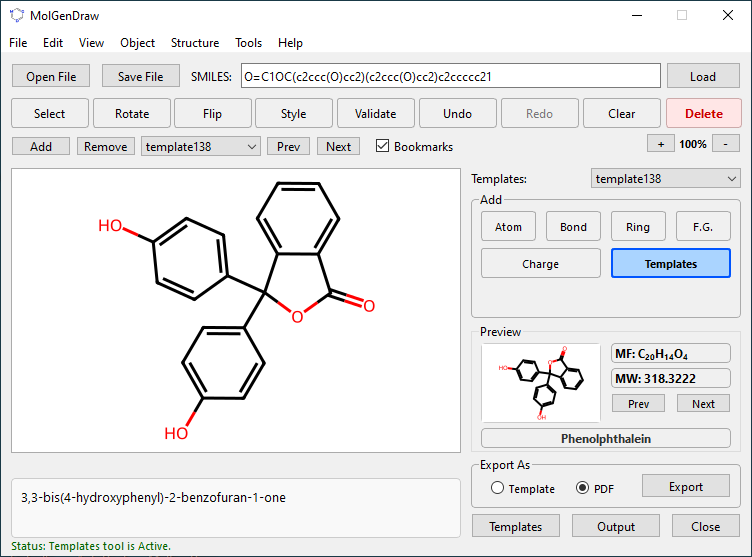  
*The clean, intuitive drawing canvas with the top control bar, tool toggles, and real-time formula display.*  

**2. Advanced SDF Database Management**  
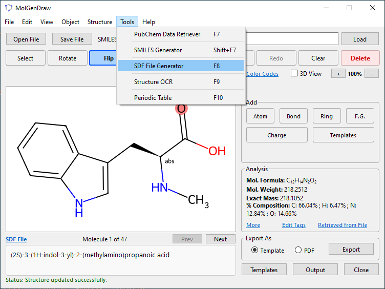  
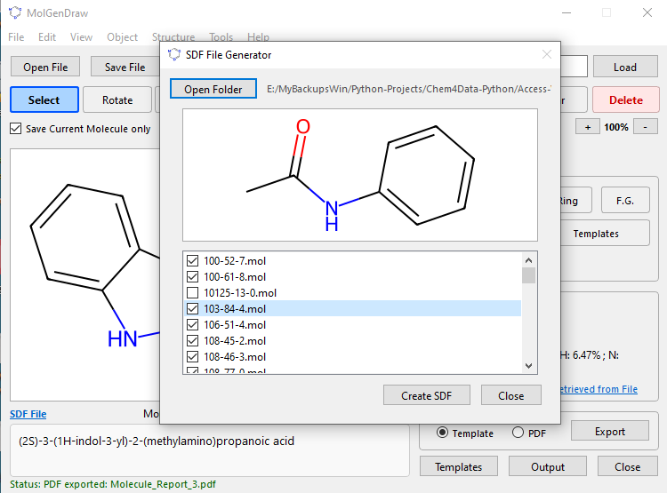  
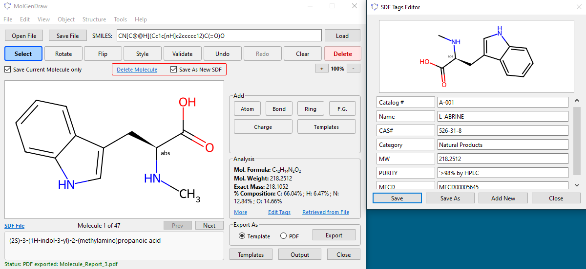  

*Navigating multi-molecule SDF files, editing custom tags, and merging standalone .mol files into a unified database.*  

**3. Real-Time Molecular Analysis & Validation**  
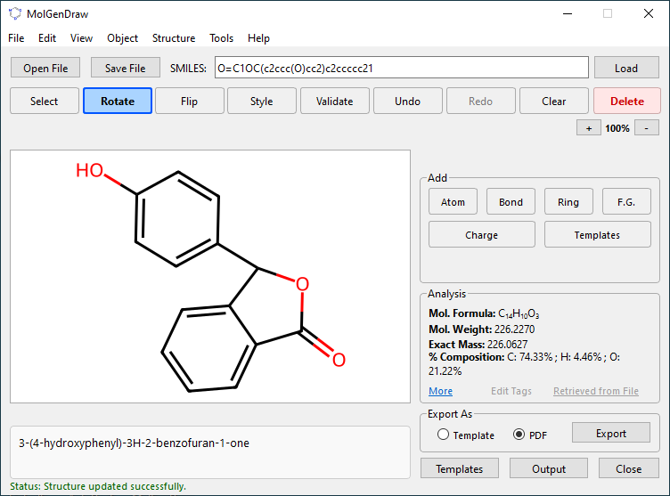  
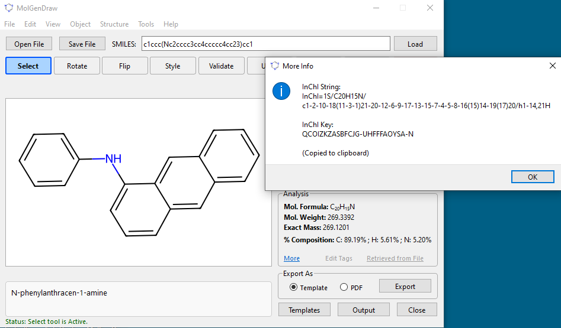  
*Live calculation of Molecular Weight, Exact Mass, InChI Key, and dynamic RDKit error tracking in the status bar.*  

**4. Delete Molecular Fragment & Merge**  
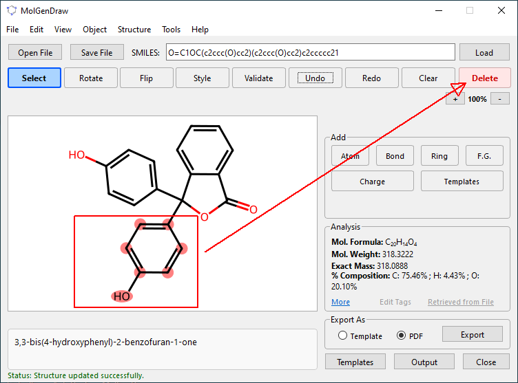  
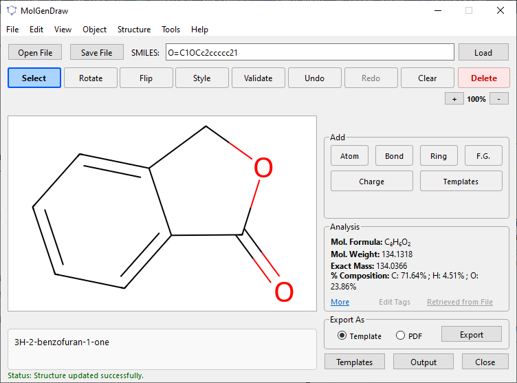  
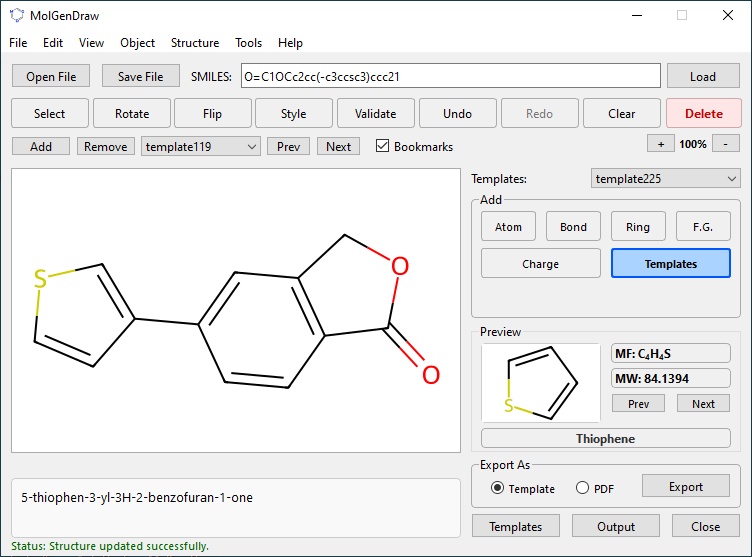  
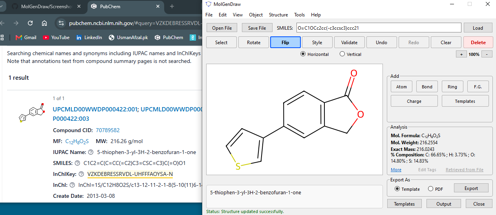  
*Delete molecular fragments and then merge with Template to create a new molecule. Press F6 Shortcut Key to search on PubChem online database.*  

**5. Interactive Periodic Table & Drawing Tools**  
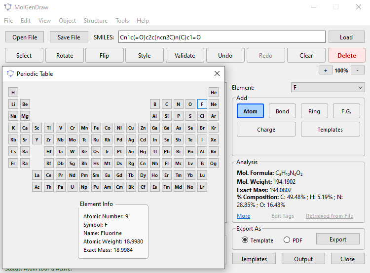  
*Selecting elements directly from the built-in periodic table with detailed atomic info, alongside ring fusion tools.*  

**6. Export Options & PDF Reports**  
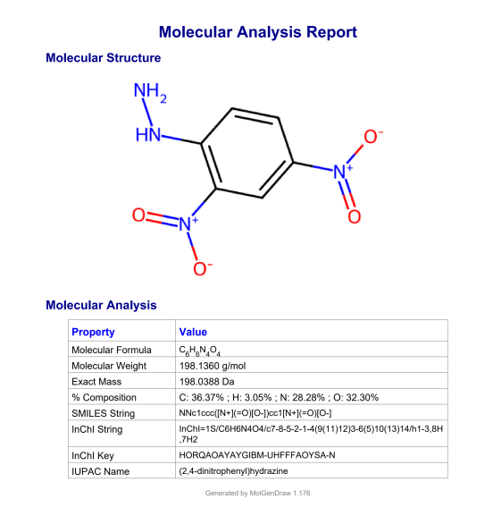  
*Generating professional A4 PDF analysis reports and transparent PNG images of the drawn structures.*  

**7. PubChem Data Integration**  
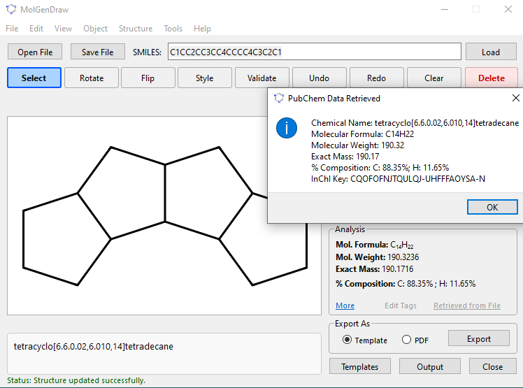  
*Fetching comprehensive compound data from the PubChem API, auto-loading the structure onto the canvas, and auto-copying data to the clipboard.*  

**8. 3D Molecular Visualization & Animation** *(New in v1.176)*  
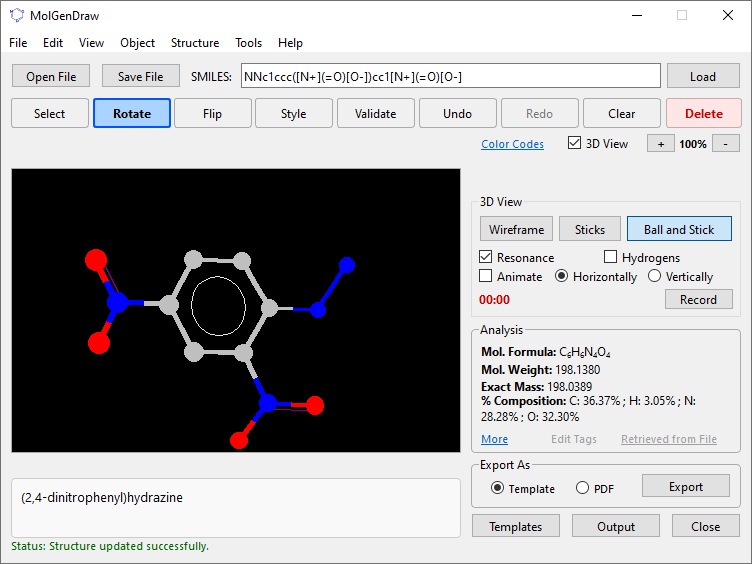
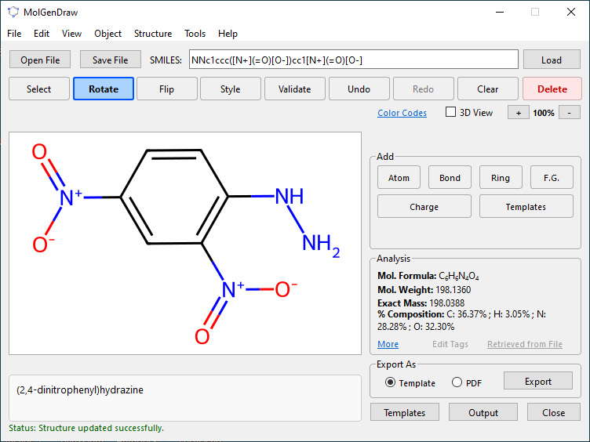
*Interactive 3D view with WireFrame, Sticks, and Ball & Stick rendering modes, auto-rotation, and MP4 video recording.*  

**9. Structure OCR Utility** *(New in v1.176)*  
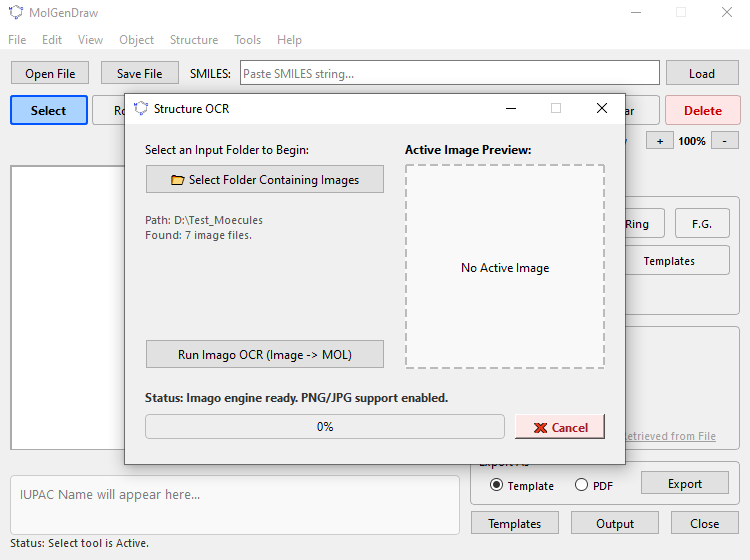
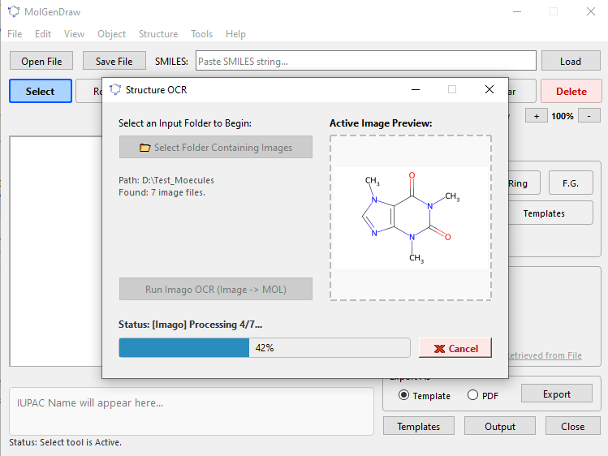
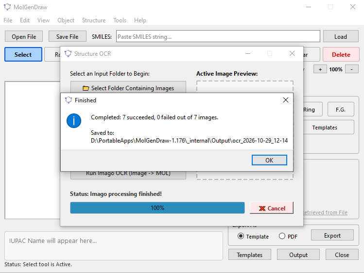
*Converting batches of PNG/JPG chemical structure images into editable MOL files, saved automatically in a timestamped `ocr_date-time` folder under the `Output` directory.*  

**10. IUPAC-to-SMILES Batch Generator** *(New in v1.176)*  
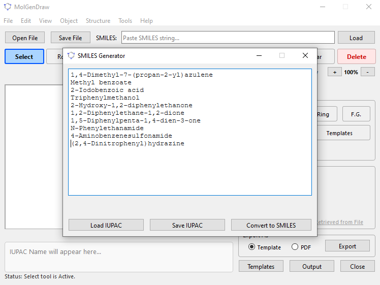
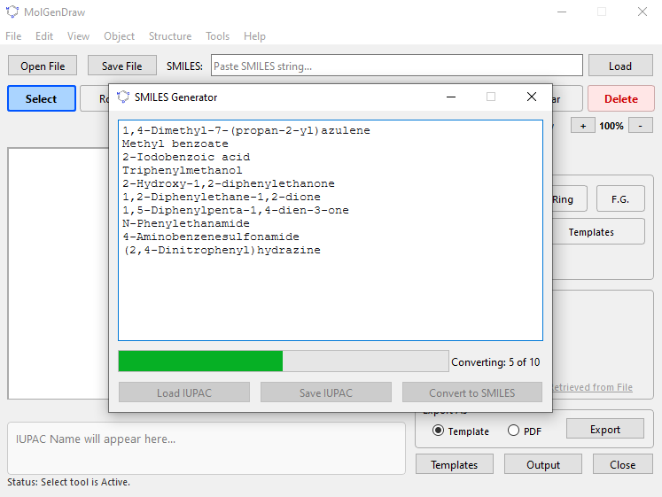
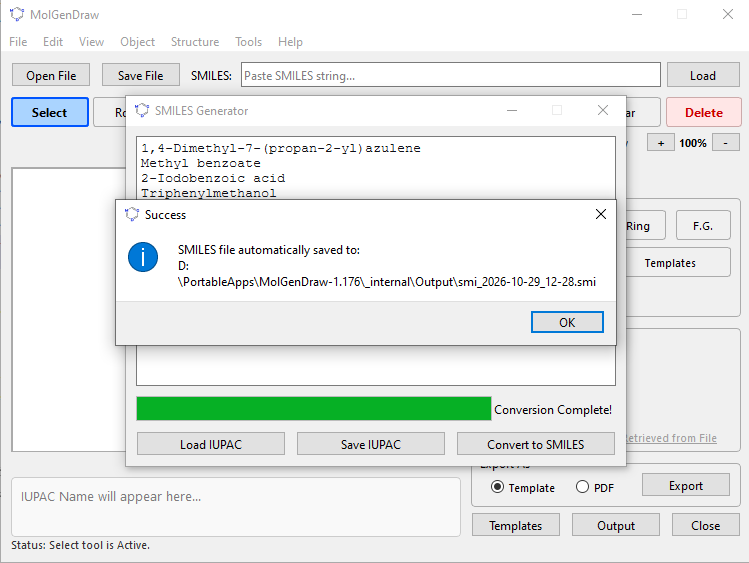
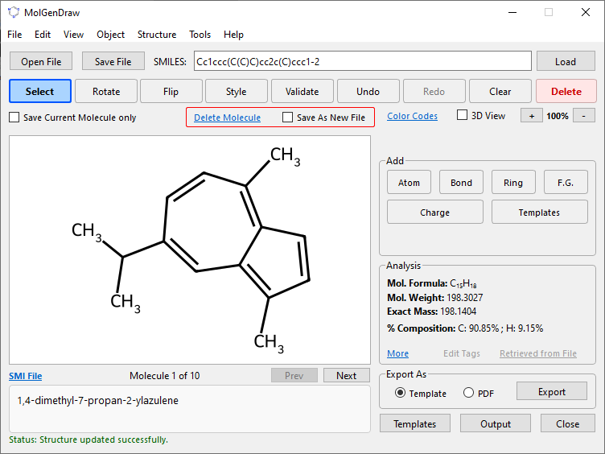
*Batch-converting IUPAC names—typed one per line or loaded from a text file—into a timestamped `.smi` file under the `Output` folder, ready to open in MolGenDraw as a navigable molecular database.*  

**11. Enhanced Multi-Molecule SMILES File Management** *(New in v1.176)*  
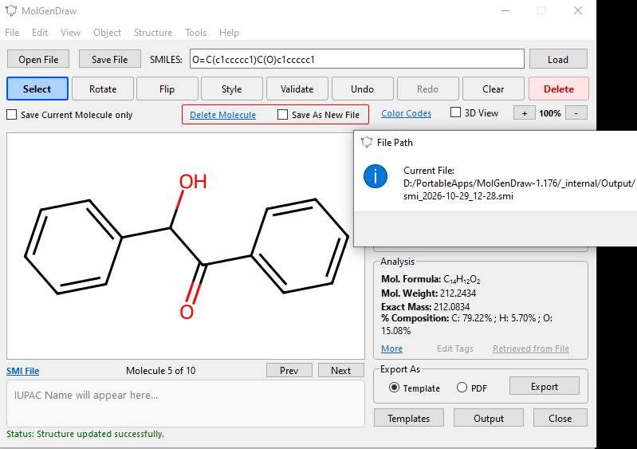  
*Loading multi-record `.smi` files, navigating between records, deleting the currently displayed molecule, saving the collection as a new `.smi` file, or exporting only the current molecule as MOL, SMI, SDF, or PNG.*  

**12. About the Software & Author**  
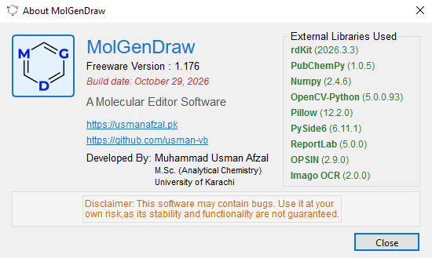  
*Version history, build details, and direct links to the developer's website and GitHub repository.*  

---

⚙️ **System Requirements**  

- **Operating System**: Windows 10 or Windows 11 (64-bit)  
- **Dependencies**: **None**. The software is fully self-contained. No Python installation or external libraries required!  

---

🚀 **How to Download and Run**  

MolGenDraw is distributed as a portable, standalone Windows executable. No installation wizard is needed.  

1. Navigate to the **[Releases](https://github.com/usman-vb/MolGenDraw/releases)** section on the right-hand sidebar of this GitHub repository.  
2. Download the latest ZIP archive (e.g., `MolGenDraw-1.176.zip`).  
3. Extract the contents of the ZIP file to any folder on your computer (e.g., `C:\MolGenDraw-1.176` or your Desktop).  
4. Double-click **`MolGenDraw.exe`** to launch the application.  
5. *(Optional)* Right-click the `.exe` file, select **Send to > Desktop (create shortcut)** for easy future access.  

> **⚠️ Windows SmartScreen Notice:**  
> Because this software is independently compiled and not signed with an expensive enterprise digital certificate, Windows Defender SmartScreen might flag it upon the first run. If this happens, simply click **"More info"** and then **"Run anyway"** to start the program safely.  

---

👨‍💻 **Developer**  

**Usman Afzal**  
🌐 Website: [https://www.usmanafzal.pk](https://www.usmanafzal.pk)  
🐙 GitHub: [https://github.com/usman-vb](https://github.com/usman-vb)  

---

🔮 **Planned Enhancements**  

- 3D conformer generation and energy minimization.  
- Advanced reaction drawing and arrow tools.  
- Batch SMILES-to-Structure conversion with progress tracking.  
- Dark mode UI theme.  

---

📜 **Version History**  

| Version | Date | Release Notes |
|---------|------|---------------|
| **v1.176** | October 29, 2026 | **Second Official Stable Release.** Added 3D molecular visualization with animation (WireFrame/Sticks/Ball & Stick), MP4 animation recording (720p, 20-sec limit), Structure OCR utility (PNG/JPG → MOL batch conversion), IUPAC-to-SMILES batch generator, enhanced multi-molecule `.smi` file management, PubChem search auto-loads structure to canvas, new F7/Shift+F7/F8/F9/F10 shortcuts, fixed 3D coordinate distortion in 2D canvas, and normalized molblock headers for RDKit parsing. |
| v1.152 | July 27, 2026 | **First Official Stable Release.** Added SDF molecule navigation shortcuts, "Save Current Molecule Only" option, delete-and-save SDF records, bookmarks with navigation buttons, refined PubChem retrieval, search via InChI Key, CH3/CH2 label & hydrogen toggles, transparent PNG export, bond width adjustment, and comprehensive About/Version History dialogs. |
| Beta 0.112 | June 20, 2026 | Introduced Advanced SDF File Management; SDF Tag Editor; SDF File Generator; and Delete Molecule functionality with confirmation dialogs. |
| Beta 0.65 | May 10, 2026 | Added Interactive Periodic Table; PDF Report Export with auto-wrapping tables; and PubChem Data Retriever with clipboard integration. |
| Alpha 0.31 | April 05, 2026 | Initial testing release featuring the core 2D Canvas; SMILES parsing; basic file I/O (.mol, .smi); and real-time molecular formula calculation. |

---

⚠️ **Disclaimer**  
This software is provided as freeware. It may contain bugs. Use it at your own risk, as its stability and functionality are not guaranteed for critical clinical or industrial applications without independent validation.  

© 2026 MolGenDraw. All Rights Reserved.
